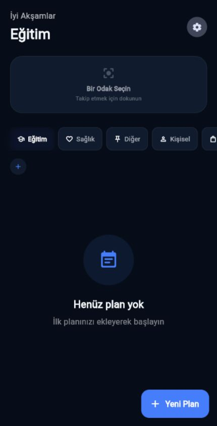
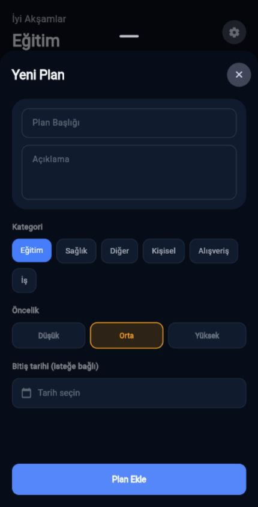

<div align="center">
  

  # TimeTable

  **A focused, offline-first planner for turning busy days into clear next steps.**

  [](https://github.com/emirhancaman/TimeTable/actions/workflows/ci.yml)
  [](https://flutter.dev)
  [](LICENSE)
  [](#platform-support)

  [Türkçe dokümantasyon](docs/README.tr.md)
</div>

---

TimeTable is a Flutter productivity app for daily planning, recurring routines, focus tracking, and at-a-glance progress. Data stays on the device through Hive, so the core experience works without an account or internet connection.

| Home | Add a plan |
| :---: | :---: |
|  |  |

## Highlights

- Plan one-off tasks, weekly routines, or selected weekdays.
- Organize work with categories, subcategories, priorities, and favorites.
- Track a chosen focus area and completion progress.
- Switch between Turkish and English, light and dark themes.
- See the next plan from the Android home-screen widget.
- Keep all planner data local with no sign-up or cloud dependency.

## Tech stack

| Area | Choice |
| --- | --- |
| UI | Flutter and Material 3 |
| State | Provider / `ChangeNotifier` |
| Persistence | Hive |
| Localization | Flutter localizations + `intl` |
| Native integration | Android home-screen widget |
| Quality | Flutter analyzer, widget tests, GitHub Actions |

## Getting started

### Requirements

- Flutter 3.38 or newer
- Dart 3.10 or newer
- Android Studio or VS Code with Flutter tooling

### Run locally

```bash
git clone https://github.com/emirhancaman/TimeTable.git
cd TimeTable
flutter pub get
flutter run
```

When a Hive model changes, regenerate its adapter:

```bash
dart run build_runner build --delete-conflicting-outputs
```

## Quality checks

Run the same checks used by CI before opening a pull request:

```bash
dart format --output=none --set-exit-if-changed lib test
flutter analyze --fatal-infos
flutter test
```

## Project structure

```text
lib/
├── models/       # Hive entities and generated adapters
├── providers/    # Application state and use-case orchestration
├── screens/      # User-facing flows
├── services/     # Persistence and platform integrations
├── theme/        # Material theme tokens
├── utils/        # Localization helpers
└── widgets/      # Reusable UI components
```

For design decisions and data flow, see [Architecture](docs/ARCHITECTURE.md).

## Platform support

| Platform | Status | Notes |
| --- | --- | --- |
| Android | Primary | Full app and home-screen widget |
| Web | Supported UI | Platform widget integration is disabled |
| Windows | Supported UI | Platform widget integration is disabled |
| iOS | Source included | Native widget setup is not yet provided |

## Contributing

Bug reports and focused pull requests are welcome. Read [CONTRIBUTING.md](CONTRIBUTING.md) before starting. Security issues should follow [SECURITY.md](SECURITY.md), not the public issue tracker.

## License

Distributed under the MIT License. See [LICENSE](LICENSE).
